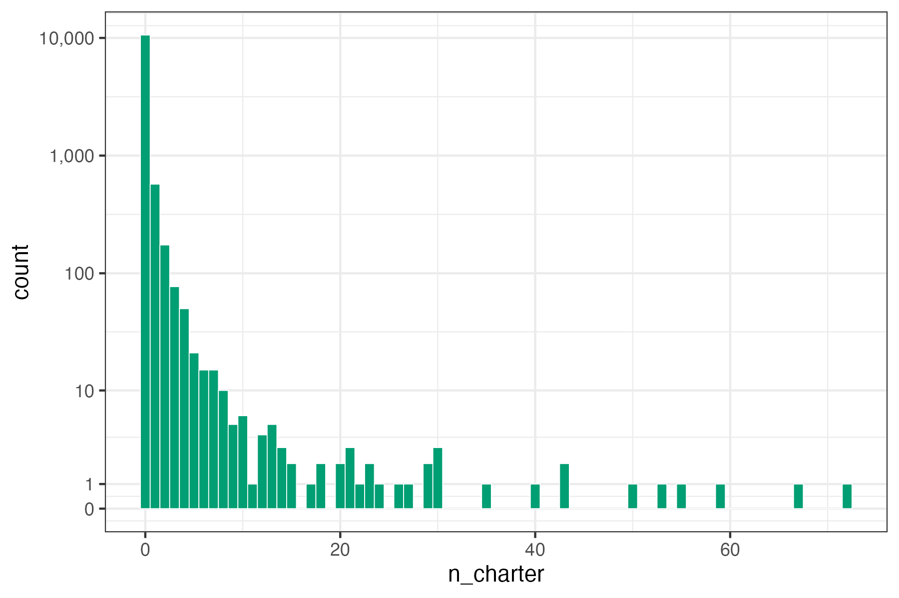
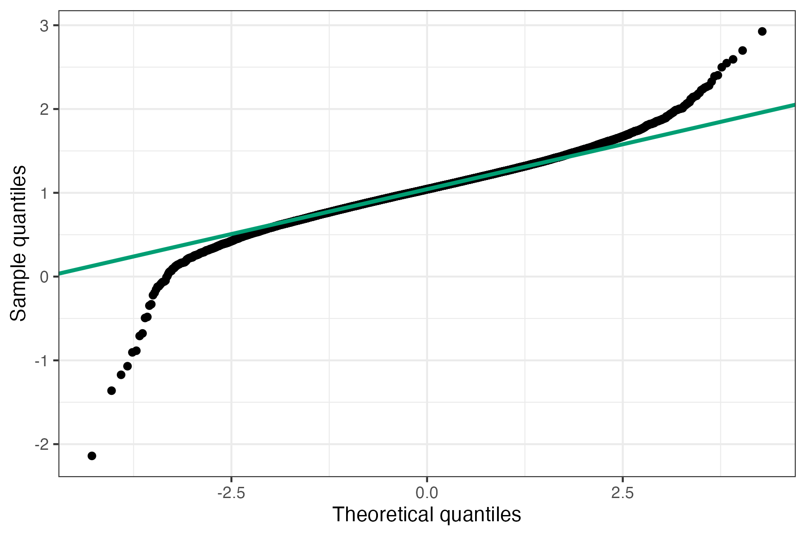
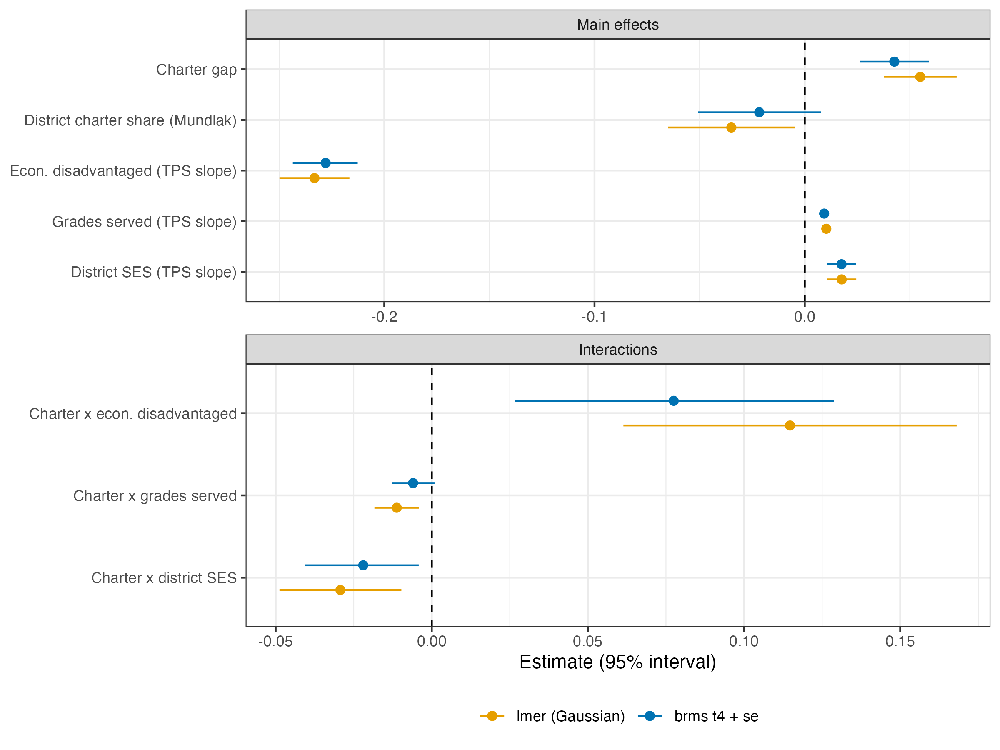

# Charter and Traditional Public Schools in a Multilevel Frame

### Variance components, response surfaces, and measurement error in SEDA 6.0

Author: Thomas Szymanski

------------------------------------------------------------------------

## Overview

This project uses the Stanford Education Data Archive (SEDA 6.0) to study how school **learning rates** (and, as a companion outcome, **average achievement**) vary across states, districts, and schools in the United States. It also asks how that variation **differs between charter schools and traditional public schools (TPS)**.

The analysis is descriptive. Charter/TPS status is treated as a grouping that may reshape the entire structure of the multilevel model:

- **how much variance** sits at the state, district, and school levels;
- **the response surface**, meaning the functional form linking the outcome to school composition and district context;
- **how precisely** each school's outcome is measured, since charter schools tend to be smaller and their estimates noisier.

A separate, secondary analysis models the **ecological selection of schools into the charter sector**. "Ecological" means it uses school- and district-level aggregates, not student-level data.

The emphasis throughout is on choosing an appropriate multilevel model and testing its robustness.

------------------------------------------------------------------------

## Data

**Source:** Reardon, S. F., Ho, A. D., Shear, B. R., Fahle, E. M., Kalogrides, D., Saliba, J., et al. *Stanford Education Data Archive (Version 6.0).* <https://purl.stanford.edu/xh833nn4025>

- U.S. public schools, grades 3–8, math and reading/ELA state tests, school years 2008–09 through 2018–19.
- All states linked to a **common NAEP-based scale**, so schools are comparable across states.
- Metric: **GCS (grade cohort scale)**. 4 equals the national average NAEP 4th-grade score, and one unit is roughly one grade level. A learning rate of 1 means one grade level of growth per grade.
- Every estimate comes with a **standard error**.

### Files (CSV, "pool" form: pooled across years, grades, and subjects)

| File | Unit | Role |
|----|----|----|
| `seda_school_pool_gcs_6.0` | school | Outcomes and their standard errors |
| `seda_cov_school_pool_6.0` | school | School covariates; contains `sedalea` (geographic district) and `stateabb`, which define the nesting |
| `seda_cov_geodist_pool_6.0` | geographic district | District covariates, linked on `sedalea` |
| `seda_crosswalk_6.0` | school × year | Year-by-year charter status, virtual-school flag, latitude/longitude |

### Key variables

| Variable | File | Description |
|----|----|----|
| `gcs_mn_lrn_ol`, `gcs_mn_lrn_ol_se` | outcomes | **Learning rate** (growth per grade) and its SE (primary outcome) |
| `gcs_mn_avg_ol`, `gcs_mn_avg_ol_se` | outcomes | **Average achievement** and its SE (companion outcome) |
| `charter` | school covariates / crosswalk | Charter status (CCD 2018; yearly in crosswalk) |
| `perecd` | school covariates | Share of economically disadvantaged students |
| `lep` | school covariates | Share of limited-English-proficient students (CRDC average) |
| `perwht`, `perblk`, `perhsp`, `perasn`, … | school covariates | Race/ethnicity shares |
| `totenrl`, `mingrd`, `maxgrd`, `level` | school covariates | Enrollment and grade span |
| `sesavgall` | district covariates | ACS socioeconomic composite |
| `perell`, `urbanicity`, `hsecdnec` | district covariates | \% English learners, locale, economic segregation |

### Data access

SEDA is free to download after accepting a data use agreement, which does not allow redistribution. **This repository contains code only.** To reproduce the analysis, download the files above from the [SEDA archive](https://edopportunity.org/get-the-data/seda-archive-downloads) and place them in `data/`. The analysis file `data/seda_an` is built by the `eval = FALSE` chunks in the `.Rmd` and then read back in for re-runs.

------------------------------------------------------------------------

## Design

Cross-sectional, three-level nesting:

```         
state (50 + DC)
 └── geographic district (~12,400; key: sedalea)
      └── school (~64,000; key: sedasch)   ← sector: charter vs. TPS
```

Structural features that shape the modeling:

- **Charter/TPS status varies within districts.** About 10% of districts contain charter schools. After dropping schools with missing learning rates, about 930 districts contain both charters and TPS (roughly 2,900 charters and 18,700 TPS). Only these districts directly inform the *within-district* contrast and the district-level covariance between charters and TPS.
- **"District" means something different for charters and TPS.** SEDA 6.0 places charter schools in the geographic district where they physically sit. For a charter, the district effect therefore reflects local context (neighborhood, labor market, peer schools), not governance by that district.
- **Many single-school districts**, mostly rural. They identify little about district-level variance.
- **States with few or no charter schools** contribute TPS information only, which limits how well state-level charter variance can be estimated.
- **Non-geographic placeholder districts** (705 schools in 69 state-level placeholders) have no district covariates.

\
*Figure 1. Number of charter schools per geographic district, with a log-scaled count axis. About 10,000 districts have no charter schools, and a handful have more than 50, so only a small share of districts informs the charter/TPS contrast.*

------------------------------------------------------------------------

## Research questions

### RQ1 (primary): How do the variance components and the response surface differ between charter and traditional public schools, controlling for district and state?

- **1a. Variance partition by charter/TPS.** How is the variance in school learning rates split across states, districts, and schools, and is that split different for charters and TPS? Are charter schools more heterogeneous within a district than TPS, and are a district's charter and TPS outcomes correlated?
- **1b. Response surface by charter/TPS.** Does the functional form of the outcome given school composition (poverty, English learners, race/ethnicity, enrollment, grade span) and district context (SES) differ between charters and TPS? This includes slopes, nonlinearity, and within- vs. between-district relationships.
- **1c. Signal vs. noise.** How much of the apparent between-school variance, and of any charter/TPS difference in that variance, is sampling error rather than true variation?

### RQ2 (secondary, modeled separately): Which school and district characteristics are associated with a school being a charter?

This is an **ecological** analysis. School composition is partly a *consequence* of charter status (who enrolls), so the model describes how charters and TPS differ and where charters are located. It does not explain why families choose them.

------------------------------------------------------------------------

## Data issues

- **Missing learning rates.** Learning rates are missing far more often than average achievement, and much more often for charter schools than for TPS. Some are structurally undefined (too few tested grades to estimate growth); others are suppressed (small cells or imprecision).
- **Heterogeneous sampling error.** Standard errors vary widely across schools. Smaller schools, and schools testing fewer grades, have noisier estimates.
- **Raw vs. empirical-Bayes estimates.** SEDA provides both raw (`_ol`) and already-shrunken empirical-Bayes (`_eb`) estimates. The raw estimates are used to avoid shrinking twice inside a multilevel model.
- **Changes in charter/TPS status over time.** Some schools converted to or from charter status during 2009–2019, so a single label is ambiguous for them.
- **Virtual schools.** Virtual schools have no meaningful physical location and are flagged separately.
- **Co-located schools.** Some charter schools share a building with a TPS, which shows up as identical coordinates in the crosswalk.
- **Non-geographic placeholder districts.** A small number of schools sit in state-level placeholder districts with no district covariates.
- **Single-school districts.** Many rural districts contain only one school.
- **Special-education schools.** Schools serving mainly special-education populations are not comparable to general schools.
- **Free/reduced-price lunch measures.** The Community Eligibility Provision distorts these, so the economically-disadvantaged share (`perecd`) is used instead.

------------------------------------------------------------------------

## Analysis

All code and annotations are in `mlms_on_seda.Rmd`, and the knitted output is `mlms_on_seda.pdf`. Figures are saved to `figs/`. Small fitted objects (the ecological models and a results cache) are in `model-objects/`. The large `brms` fits (`fit.*.RDS`, several hundred MB each) are not in the repository; they are refit by the `.Rmd`.

A pruned version of the master `.Rmd`, `mlms_on_seda_report.Rmd`, knits to `mlms_on_seda_report.pdf`: a short report (at most 10 pages) laid out as Data, Methods, and Results, followed by a summary of findings and concerns for feedback. Its prose is taken verbatim from `mlms_on_seda.Rmd` and this README. It reads its results from `model-objects/report_cache.rds` and `figs/`, so it knits in seconds without refitting the models; rebuild the cache if the master models change.

The `.Rmd` follows this order:

1.  **Introduction and data processing.** Joins the four SEDA files into one school-level file and builds the analysis sample (`seda_an`, 54,074 schools in 11,569 districts and 51 states: 2,998 charters and 51,076 TPS). Schools with missing learning rates, no school covariates, special-education or virtual schools, or missing covariates are dropped, and an attrition table is produced.
2.  **Ecological analysis (RQ2).** A logistic regression of charter status on school characteristics and their district means (a within/contextual decomposition), fit to the 925 districts that contain both Charter and TPS schools, and a negative binomial regression of the count of charters per district with an offset for the number of schools.
3.  **Exploratory analysis.** Outcome density and QQ plot (heavy tails), the Charter/TPS frequency table, and a pairs plot.
4.  **Baseline and random effects models (RQ1a).** An unconditional means model, a charter fixed effect, a Mundlak term (the centered district charter share), district effects specific to Charter/TPS status, and a full model with all predictors, compared by likelihood-ratio tests (REML or ML as appropriate), AIC and BIC (grouped together), variance components, pseudo-R², and residual and BLUP diagnostics.
5.  **Interaction model (RQ1b).** Charter/TPS status interacted with school composition and district SES, tested with a joint Wald test and a likelihood-ratio test, with residual diagnostics and an examination of the extreme residuals against the reported standard errors.
6.  **Robustness extension (RQ1c).** Bayesian refits in `brms` with priors checked by prior predictive simulation. Four fits are compared by PSIS-LOO and WAIC: Gaussian errors, Student-t errors with the degrees of freedom fixed at 4, and each of those with the reported standard errors passed through `se()`. A forest plot compares key coefficients across all five fits, and a t4 QQ plot checks the tail assumption.
7.  **Summary of findings.**

\
*Figure 2. Normal QQ plot of the learning-rate outcome. The tails are heavier than a Gaussian error model allows, which motivates the Student-t refits.*

### Main results

- About 80% of the variance in learning rates is within districts, 13% between districts, and 7% between states.
- The within-district Charter/TPS gap shrinks from +0.085 to +0.043 once composition is controlled. The effects of the predictors are not homogeneous across Charter/TPS status: the joint Wald test on the nine interaction terms rejects equal slopes (chi-square = 130 on 9 df), and three interactions are distinguishable from zero. For charters, the slope is the TPS slope plus the interaction term, net of the other predictors and of the district- and state-level random effects.
  - **Economic disadvantage:** -0.233 for TPS, and -0.233 + 0.115 = -0.118 for charters. A 10-percentage-point higher share is associated with a learning rate 0.023 GCS lower in TPS and 0.012 GCS lower in charters, so poverty is associated with lower learning rates in both, about half as steeply in charters.
  - **Grade span:** +0.010 per additional grade for TPS, and about zero (+0.010 - 0.011) for charters. A broader grade span is associated with a higher learning rate in TPS, but not in charters. This interaction keeps its sign but is not distinguishable from zero under the t4 fits.
  - **District SES:** +0.018 for TPS, and -0.012 (+0.018 - 0.029) for charters. The slopes have opposite signs: a higher-SES district is associated with higher learning rates in its TPS, but not in its charters.
  - The other six interactions (LEP, Black, Hispanic, and Asian shares, enrollment, and district economic disadvantage) are not distinguishable from zero in the `lmer` fit (the Black share interaction only just becomes so under t4 + se), and the signs of the three interactions above are the same across all five fits.
- A Student-t (4 df) error structure that also uses the reported standard errors is clearly preferred under LOO-CV. The signs of the main Charter/TPS and interaction findings hold under it, and the charter gap and the economic disadvantage and district SES interactions remain distinguishable from zero. The grade span interaction and the district charter share (Mundlak) term do not.

\
*Figure 3. Key coefficients (95% intervals) from the Gaussian `lmer` fit and the `brms` Student-t (4 df) fit that also uses the reported standard errors. The signs agree across fits. The grade span interaction and the district charter share (Mundlak) term are no longer clearly distinguishable from zero under t4 + se.*

Other diagnostic plots (residuals by level, standard error distributions, pairs plot) are in `figs/`.

- **Variance partition.** In the baseline model charter schools vary less across districts than TPS do, and the two district effects are positively correlated (0.51 in the baseline model, 0.29 in the full model). The interaction model puts the within-district charter gap at +0.055 at the centered means.
- **Ecological analysis (RQ2).** Within a district, charters tend to be smaller and to span more grades than TPS, and their composition differs. The share of charters in a district depends heavily on the state.

------------------------------------------------------------------------

## Reproducing

1.  Download the SEDA 6.0 files listed above into `data/`.
2.  Knit `mlms_on_seda.Rmd`. The `eval = FALSE` chunks build `data/seda_an`; the `brms` fits are slow, so budget time for them.
3.  Required R packages: `lme4`, `lmerTest`, `tidyverse`, `see`, `GGally`, `nlme`, `glmmTMB`, `DHARMa`, `scales`, `brms`.
