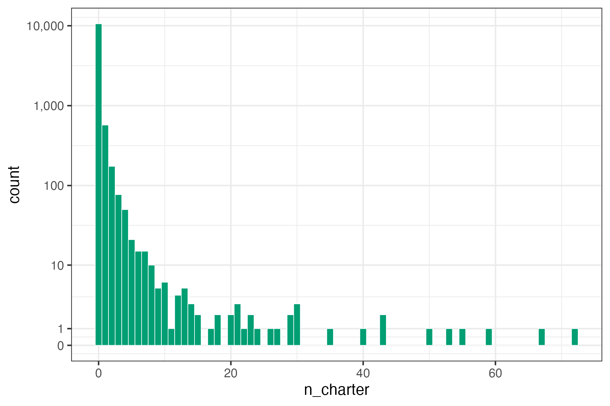
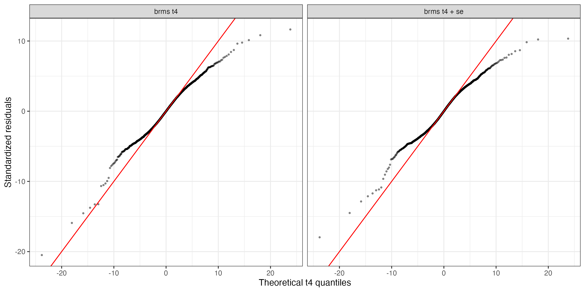

```{r setup, include=FALSE}
knitr::opts_chunk$set(echo = FALSE, message = FALSE, warning = FALSE,
                      fig.align = "center", fig.pos = "H", dev = "png", dpi = 200,
                      out.width = "100%")
options(knitr.kable.NA = "", width = 100, knitr.table.format = "latex")
Sys.setenv(LANGUAGE = "en")
suppressPackageStartupMessages({
  library(tidyverse); library(see); library(patchwork); library(knitr)
})

seda_an <- read_csv("data/seda_an", show_col_types = FALSE) |>
  mutate(status = factor(charter, levels = 0:1, labels = c("TPS", "Charter")))

# all fitted results (lmer M0-M5, brms LOO/coefficients, ecological models)
res <- readRDS("model-objects/report_cache.rds")

f2 <- function(x) formatC(x, format = "f", digits = 2)
f3 <- function(x) formatC(x, format = "f", digits = 3)
fp <- function(p) ifelse(p < 0.001, "<0.001", formatC(p, format = "f", digits = 3))
est_se <- function(e, s, d = 3) sprintf(paste0("%.", d, "f (%.", d, "f)"), e, s)
```

# Introduction

This document studies how school learning rates in SEDA 6.0 vary across states, districts, and schools, and how that variation differs between charter schools and traditional public schools (TPS). The data are cross-sectional and nested in three levels: schools within geographic districts within states, with Charter/TPS status varying within districts. RQ1 asks how the variance components and the response surface differ by Charter/TPS status, controlling for district and state. RQ2 asks, ecologically, which school and district characteristics are associated with a school being a charter.

- **1a. Variance partition by charter/TPS.** How is the variance in school learning rates split across states, districts, and schools, and is that split different for charters and TPS? Are charter schools more heterogeneous within a district than TPS, and are a district's charter and TPS outcomes correlated?
- **1b. Response surface by charter/TPS.** Does the functional form of the outcome given school composition (poverty, English learners, race/ethnicity, enrollment, grade span) and district context (SES) differ between charters and TPS? This includes slopes, nonlinearity, and within- vs. between-district relationships.
- **1c. Signal vs. noise.** How much of the apparent between-school variance, and of any charter/TPS difference in that variance, is sampling error rather than true variation?

# Data

**Source:** Reardon, S. F., Ho, A. D., Shear, B. R., Fahle, E. M., Kalogrides, D., Saliba, J., et al. *Stanford Education Data Archive (Version 6.0).* <https://purl.stanford.edu/xh833nn4025>

- U.S. public schools, grades 3–8, math and reading/ELA state tests, school years 2008–09 through 2018–19.
- All states linked to a **common NAEP-based scale**, so schools are comparable across states.
- Metric: **GCS (grade cohort scale)**. 4 equals the national average NAEP 4th-grade score, and one unit is roughly one grade level. A learning rate of 1 means one grade level of growth per grade.
- Every estimate comes with a **standard error**.

**Introduction and data processing.** Joins the four SEDA files into one school-level file and builds the analysis sample (`seda_an`, 54,074 schools in 11,569 districts and 51 states: 2,998 charters and 51,076 TPS). Schools with missing learning rates, no school covariates, special-education or virtual schools, or missing covariates are dropped, and an attrition table is produced.

```{r tab-desc}
both <- seda_an |> summarise(nsec = n_distinct(charter), .by = sedalea) |>
  filter(nsec == 2) |> nrow()
desc_fun <- function(d) summarise(d,
  Schools = n(), Districts = n_distinct(sedalea),
  `Learning rate, mean (SD)` = sprintf("%.2f (%.2f)", mean(gcs_mn_lrn_ol), sd(gcs_mn_lrn_ol)),
  `Reported SE, mean (SD)` = sprintf("%.3f (%.3f)", mean(gcs_mn_lrn_ol_se), sd(gcs_mn_lrn_ol_se)),
  `Econ. disadvantaged, mean` = f2(mean(perecd)),
  `Enrollment, median` = as.character(round(median(totenrl))),
  `Grades served, mean` = f2(mean(n_grades)))
desc_t <- bind_rows(
  seda_an |> group_by(status) |> desc_fun() |> mutate(status = as.character(status)),
  seda_an |> desc_fun() |> mutate(status = "All")) |>
  mutate(across(c(Schools, Districts), ~ format(.x, big.mark = ",")))
desc_t <- as.data.frame(t(desc_t[, -1])); colnames(desc_t) <- c("TPS", "Charter", "All")
kable(desc_t, booktabs = TRUE, align = "rrr",
      caption = paste0("Analysis sample by Charter/TPS status (",
                       n_distinct(seda_an$stateabb), " states; ", both,
                       " districts contain both)."))
```

```{r fig-charter-count, out.width="55%", fig.cap="Number of charter schools per geographic district, with a log-scaled count axis. About 10,000 districts have no charter schools, and a handful have more than 50, so only a small share of districts informs the charter/TPS contrast."}

```

Displaying a QQ plot of the outcome. This confirms non-normality: the plot exposes very fat tails in both directions, with the lower tail more extreme (down to about -2.1).

Plotting a histogram of the reported standard errors for the learning rate outcome variable for the entire analysis sample. The reported standard errors range from about 0.02 to 0.15 and are right-skewed, which is why the extension below treats them as information about measurement error.

```{r fig-eda, fig.width=7, fig.height=2.1, fig.cap="(A) Normal QQ plot of the learning-rate outcome; (B) learning-rate density by Charter/TPS status; (C) reported standard errors by Charter/TPS status."}
pA <- ggplot(seda_an, aes(sample = gcs_mn_lrn_ol)) +
  stat_qq(size = 0.3, alpha = 0.4) +
  stat_qq_line(colour = okabeito_colors(3), linewidth = 0.8) +
  labs(x = "Theoretical quantiles", y = "Sample quantiles", title = "A") +
  theme_bw(base_size = 8)
pB <- ggplot(seda_an, aes(gcs_mn_lrn_ol, colour = status, fill = status)) +
  geom_density(alpha = 0.2) + coord_cartesian(xlim = c(0, 2)) +
  scale_colour_okabeito() + scale_fill_okabeito() +
  labs(x = "Learning rate (GCS)", y = "Density", colour = NULL, fill = NULL, title = "B") +
  theme_bw(base_size = 8) + theme(legend.position = c(.8, .8))
pC <- ggplot(seda_an, aes(gcs_mn_lrn_ol_se, colour = status, fill = status)) +
  geom_density(alpha = 0.2) + scale_colour_okabeito() + scale_fill_okabeito() +
  labs(x = "Reported SE", y = "Density", title = "C") +
  theme_bw(base_size = 8) + theme(legend.position = "none")
pA + pB + pC
```

# Methods

1.  **Ecological analysis (RQ2).** A logistic regression of charter status on school characteristics and their district means (a within/contextual decomposition), fit to the 925 districts that contain both Charter and TPS schools, and a negative binomial regression of the count of charters per district with an offset for the number of schools.
2.  **Baseline and random effects models (RQ1a).** An unconditional means model, a charter fixed effect, a Mundlak term (the centered district charter share), district effects specific to Charter/TPS status, and a full model with all predictors, compared by likelihood-ratio tests (REML or ML as appropriate), AIC and BIC (grouped together), variance components, pseudo-R², and residual and BLUP diagnostics.
3.  **Interaction model (RQ1b).** Charter/TPS status interacted with school composition and district SES, tested with a joint Wald test and a likelihood-ratio test, with residual diagnostics and an examination of the extreme residuals against the reported standard errors.
4.  **Robustness extension (RQ1c).** Bayesian refits in `brms` with priors checked by prior predictive simulation. Four fits are compared by PSIS-LOO and WAIC: Gaussian errors, Student-t errors with the degrees of freedom fixed at 4, and each of those with the reported standard errors passed through `se()`. A forest plot compares key coefficients across all five fits, and a t4 QQ plot checks the tail assumption.

| Model object | Specification |
|:-----------------------------------|:-----------------------------------|
| `fit.ucm` (M0) | Fitting an unconditional means model (UCM). |
| `fit.charter.fixef` (M1) | Adding a fixed effect for charter status to the UCM. |
| `fit.charter.mundlak` (M2) | Adding a Mundlak term - the centered share of charter schools in districts - to the previous fit. |
| `fit.charter.rndm` (M3) | Adding random effects: a random intercept for state and charter/TPS status-specific district effects. |
| `fit.full.rndm` (M4) | Fitting a model with the previously added random effects and all predictors. |
| `fit.full.rndm.int` (M5) | The interaction model lets the response surface differ by Charter/TPS status, so each slope can have its own return in charter schools. |

: Model sequence (`lmer`).

Fitting a "full" model with interactions between Charter/TPS status and the school composition predictors (economically disadvantaged, LEP, Black, Hispanic, and Asian shares, enrollment, grade span), district SES, and district economic disadvantage. The charter share, economic segregation, and locale terms are not interacted.

```{r interaction-model-fit, echo = TRUE, eval = FALSE}

fit.full.rndm.int <- lmerTest::lmer(
  gcs_mn_lrn_ol ~ factor(charter) + charter_share_dist_c +
    perecd_c + lep_c + perblk_c + perhsp_c + perasn_c +
    log_enrl_c + n_grades_c +
    sesavgall_c + perecd_dist_c + hsecdnec_c + urbanicity_dist +
    factor(charter):perecd_c + factor(charter):lep_c +
    factor(charter):perblk_c + factor(charter):perhsp_c +
    factor(charter):perasn_c + factor(charter):log_enrl_c +
    factor(charter):n_grades_c + factor(charter):sesavgall_c +
    factor(charter):perecd_dist_c +
    (1 | stateabb) + (0 + factor(charter) | sedalea),
  # rndm intercept for state
  # sector-specific district effects
  data = seda_an
)

```

The Gaussian error model is easily surprised, because its thin tails put very little probability on extreme observations. Many natural phenomena have thicker tails, with rare, extreme observations that are not measurement errors but real events. A robust regression reduces the influence of such observations by replacing the Gaussian with a Student-t distribution. We do not usually try to estimate the degrees of freedom: instead we assume they are small (here, 4) in order to reduce the influence of outliers. We also pass each school's reported standard error to the model, so that the model knows how precisely each learning rate was measured.

Setting priors, fixing degrees of freedom to 4 as the first step to force a fixed t4 error structure. The other priors are mildly skeptical, regularizing priors: normal(0, 0.5) on the slopes and the tighter normal(0, 0.25) on the interactions. A regularizing prior reduces overfitting, but one that is too skeptical prevents the model from learning from the data. The LKJ(1) prior on the correlation between the district effects is flat over valid correlation matrices.

Adding each school's reported standard error through `se(..., sigma = TRUE)`: the model's residual scale is then combined with each school's own reported measurement error, so noisier schools count for less.

```{r brms-fit-t4-se, echo = TRUE, eval = FALSE}
fit.full.rndm.int.brm.t4.se <- brms::brm(
  gcs_mn_lrn_ol | se(gcs_mn_lrn_ol_se, sigma = TRUE) ~
    factor(charter) + charter_share_dist_c +
    perecd_c + lep_c + perblk_c + perhsp_c + perasn_c +
    log_enrl_c + n_grades_c +
    sesavgall_c + perecd_dist_c + hsecdnec_c + urbanicity_dist +
    factor(charter):perecd_c + factor(charter):lep_c +
    factor(charter):perblk_c + factor(charter):perhsp_c +
    factor(charter):perasn_c + factor(charter):log_enrl_c +
    factor(charter):n_grades_c + factor(charter):sesavgall_c +
    factor(charter):perecd_dist_c +
    (1 | stateabb) + (0 + factor(charter) | sedalea),
  data = seda_an,
  family = student(link = "identity"),
  prior = my_priors,
  chains = 4, cores = parallel::detectCores() - 1,
  backend = "cmdstanr", iter = 2000, seed = 42
)

```

A prior predictive simulation shows what the priors imply about observable outcomes, which helps diagnose bad choices. Comparing quantiles of the simulated and observed outcomes: the simulated outcomes span -4.8 to 6.9 (0.1% to 99.9%), against 0.18 to 1.92 observed.

Only 59% of the simulated outcomes fall between 0 and 2 GCS, against 99.9% of the observed ones. The priors are wider than the data. With 54,074 schools the likelihood dominates, so these wide priors are harmless here, but they are not tight.

```{r tab-prior-pp}
pp <- res$prior_pp
ppt <- tibble(
  ` ` = c("0.1th percentile", "Median", "99.9th percentile", "Share between 0 and 2 GCS"),
  `Prior predictive` = c(f2(pp$q_sim), f3(pp$share_sim)),
  `Observed` = c(f2(pp$q_obs), f3(pp$share_obs)))
kable(ppt, booktabs = TRUE, align = "lrr", caption = "Prior predictive check.")
```

# Results

## Variance Partition and Model Selection (RQ1a)

The UCM documents how the variation splits between and within the grouping factors. Taking the ICC as the proportion of total variance at a level, about 6.9% of the variance in learning rates is between states (0.0037), 12.7% is between districts within states (0.0068), and 80.4% is within districts, at the school level (0.0431). School-level predictors might explain some of that 80%; district- and state-level predictors might explain some of the rest.

Charters score higher than TPS by 0.076 GCS (SE 0.004), controlling for the differences between districts and states.

With the Mundlak term, the within-district charter gap rises to 0.085, and the district charter share is -0.115 (t = -7.4). Districts with more charters have lower learning rates, and the Charter/TPS coefficient is now the contrast net of that district-level difference.

A likelihood-ratio test on the model with the Mundlak term versus the same model with random effects added: since the models do not differ in fixed effects, we do not refit (i.e., we stay in REML). The random effects counterpart is preferred under the LRT (chi-square = 147.6 on 2 df, p \< 0.0001), and AIC falls from -12,120 to -12,263. A boundary-corrected p-value would be even smaller, so the conclusion does not change.

Comparing the AIC and BIC values of all the refit model objects. Both are fit by ML, since the fixed effects differ, and all five models use the same observations. AIC and BIC both fall steadily from the UCM to the full random effects model, and the full model is the best on both. Differences of about 2 BIC points are weak evidence, and these gaps run from hundreds to thousands of points, so the two criteria agree and there is no tension to resolve.

```{r tab-models}
ml_t <- res$ic |>
  mutate(`LRT chi-sq (df)` = c("", sprintf("%.1f (%d)", res$lrts[, "chisq"],
                                           as.integer(res$lrts[, "df"]))),
         `Charter gap (SE)` = c("", est_se(res$gap[2:6, 1], res$gap[2:6, 2])),
         `Mundlak (SE)` = c("", "", est_se(res$mund[3:6, 1], res$mund[3:6, 2])),
         AIC = formatC(AIC, format = "f", digits = 0, big.mark = ","),
         BIC = formatC(BIC, format = "f", digits = 0, big.mark = ","))
names(ml_t)[1:2] <- c("Model", "Par.")
kable(ml_t, booktabs = TRUE, align = "lrrrrrr",
      caption = "Information criteria (ML), likelihood-ratio tests against the previous row, and the Charter/TPS and Mundlak coefficients across M0--M5.")
```

With district effects specific to Charter/TPS status, charter schools vary less across districts (variance 0.0055) than TPS do (0.0072). The two district effects are correlated at 0.51: a district that is high for TPS tends to be high for charters too.

In the full model, the charter gap shrinks to 0.043, the Mundlak term to -0.035 (p = 0.022), and the district correlation to 0.29. The economically disadvantaged share is the largest school-level predictor (-0.223 per unit share). The Asian (+0.243), LEP (+0.071), and Hispanic (+0.060) shares are positive, and enrollment (-0.029) is negative. The Black share (p = 0.058), district economic disadvantage, economic segregation, and the rural and suburban locale terms are not distinguishable from zero.

Computing pseudo-R\^2 values: the proportional reduction in each variance component from `fit.charter.rndm` to `fit.full.rndm`. The residual (within) value is R\^2_W; the district- and state-level values are R\^2_B for their level.

```{r tab-vc}
vct <- res$vc |>
  pivot_longer(-model, names_to = "Component", values_to = "value") |>
  pivot_wider(names_from = model, values_from = value) |>
  mutate(`Pseudo-R2 (M3 to M4)` = ifelse(Component == "Corr(TPS, Charter)", NA, (M3 - M4) / M3),
         `ICC (M0)` = unname(c(res$icc["State"], res$icc["District"], NA, NA, NA,
                               res$icc["School"]))) |>
  mutate(across(c(M0, M3, M4, M5), ~ ifelse(is.na(.x), "",
           ifelse(Component == "Corr(TPS, Charter)", f2(.x),
                  formatC(.x, format = "f", digits = 4)))),
         `Pseudo-R2 (M3 to M4)` = ifelse(is.na(`Pseudo-R2 (M3 to M4)`), "",
                                         f3(`Pseudo-R2 (M3 to M4)`)),
         `ICC (M0)` = ifelse(is.na(`ICC (M0)`), "", f3(`ICC (M0)`)))
kable(vct, booktabs = TRUE, align = "lrrrrrr",
      caption = "Variance components, pseudo-R2, and ICCs.")
```

Within-district (school-level) variance falls by only about 3%, so the predictors mostly explain the between-level components. The negative value for the charter district variance means that variance increased once the predictors were added: this kind of re-shuffling is common once the mean is better specified, and it should be read alongside the change in the district correlation.

## Response Surface by Charter/TPS Status (RQ1b)

Inspecting the summary output. Three interactions are distinguishable from zero. For economic disadvantage, the slope is -0.233 for TPS and about -0.118 for charters (interaction +0.115, p \< 0.001): poverty is associated with lower learning rates in both, about half as steeply in charters. For grade span, the slope is +0.010 for TPS and about zero for charters (-0.011, p = 0.002). For district SES, the slope is +0.018 for TPS and -0.012 for charters (-0.029, p = 0.003). The other interactions are not significant. The Charter/TPS gap at the centered means falls to +0.055; the charter district variance drops (0.0078 to 0.0053), and the residual variance is unchanged (0.0411).

```{r tab-slopes}
lab <- c(perecd_c = "Econ. disadvantaged (share)", lep_c = "LEP (share)",
         perblk_c = "Black (share)", perhsp_c = "Hispanic (share)",
         perasn_c = "Asian (share)", log_enrl_c = "Log enrollment",
         n_grades_c = "Grades served", sesavgall_c = "District SES",
         perecd_dist_c = "District econ. disadvantaged")
sl <- res$slopes |>
  transmute(Predictor = lab[term],
            `TPS slope (SE)` = est_se(tps, tps_se),
            `Charter slope (SE)` = est_se(charter, charter_se),
            `Interaction (SE)` = est_se(inter, inter_se),
            `Interaction p` = fp(inter_p))
kable(sl, booktabs = TRUE, align = "lrrrr",
      caption = paste0("Slopes by Charter/TPS status from M5 (charter slope = TPS slope + interaction). Joint Wald test of the nine interactions: chi-square = ",
                       f2(res$wald["chisq"]), " on ", res$wald["df"], " df, p ",
                       fp(res$wald["p"]), "."))
```

Leveraging a Wald test to test for the joint significance of the interaction terms. The Wald test confirms that the interaction terms are jointly significant (chi-square = 130.2 on 9 df, p \< 0.0001). A Wald test uses the estimated covariance matrix of the parameter estimates, so it is not an LRT. Terms 17 to 25 are the nine interactions: `urbanicity_dist` contributes three dummy columns, so the model has 25 coefficients.

Another LRT, comparing the full random effects models with and without interaction terms: since the fixed effects are not the same, we refit the models with ML. The LRT supports the choice of the "full" model with the interaction terms added (chi-square = 121.6 on 9 df, p \< 0.0001). AIC falls from -14,992 to -15,096, and BIC also falls (-14,805 to -14,829), so both criteria favor the interaction model.

## Diagnostics

Residual plots all point towards substantial deviations from normality. The school residuals have heavy tails, with the lower tail more extreme (scaled residuals range from -15.1 to 8.0), and the BLUPs fail the normality check as well: the TPS district BLUPs, for example, show a sharp central peak and an S-shaped QQ plot, which means heavy tails. This does not mean the model is wrong, but it should be noted and followed up.

Plotting standard error values reported for the learning rate outcome variable on the residuals, exposing extreme residuals and their placement relative to the reported standard errors. The residuals form a roughly symmetric column, and the extreme residuals appear at every standard error from about 0.05 to 0.14. The most extreme, at -3.07, is about 15 residual standard deviations from zero (the residual standard deviation is 0.203).

```{r fig-resid, fig.width=7.2, fig.height=2.9, fig.cap="(A) QQ plots of the residuals and BLUPs from M5, by level; (B) reported standard errors against the M5 school residuals."}
rl <- imap_dfr(res$resid, ~ tibble(value = as.numeric(.x), level = .y)) |>
  mutate(level = factor(level, levels = names(res$resid)))
pq <- ggplot(rl, aes(sample = value)) +
  stat_qq(size = 0.3, alpha = 0.4) + stat_qq_line(colour = okabeito_colors(3)) +
  facet_wrap(~ level, scales = "free") +
  labs(x = "Theoretical quantiles", y = "Sample quantiles", title = "A") +
  theme_bw(base_size = 7)
ps <- tibble(eps = as.numeric(res$resid$`School residuals`),
             se = seda_an$gcs_mn_lrn_ol_se) |>
  ggplot(aes(x = eps, y = se)) +
  geom_point(size = 0.3, alpha = 0.3) +
  labs(x = "School residual (M5)", y = "Reported SE", title = "B") +
  theme_bw(base_size = 7)
pq + ps + plot_layout(widths = c(1.6, 1))
```

Retrieving the extreme residual entries through indexing and constructing a data frame. The extreme residuals are those with an absolute value greater than 1, about 5 residual standard deviations: 40 schools, 21 negative and 19 positive. Of these, 39 are TPS and 1 is a charter.

## Robustness: t4 Errors and Reported Standard Errors (RQ1c)

Reading in the t4 fit and inspecting the summary. The fixed effects are close to the Gaussian ones, but the residual scale is much smaller (0.15 against 0.20), because the thick tails absorb the extreme observations. The district and state standard deviations are unchanged (about 0.07 and 0.06). The charter share coefficient moves from -0.03 to -0.02, and its interval now includes zero; the economic disadvantage interaction falls from 0.11 to 0.08.

Posterior predictive check and LOO diagnostics. PSIS-LOO gives one Pareto k per observation, and large k values flag influential observations. The t4 fit has no observation with k above 0.7 (the maximum is about 0.59), whereas the Gaussian fit has 4. The relative influence of the extreme schools has been much reduced.

```{r tab-loo}
nice <- c(gaussian = "Gaussian", t4 = "Student-t (4 df)",
          gaussian_se = "Gaussian + se()", t4_se = "Student-t (4 df) + se()")
lt <- res$brms$cmp |>
  mutate(Model = nice[model],
         `ELPD diff.` = f2(elpd_diff), `SE diff.` = f2(se_diff),
         `Pareto k > 0.7` = as.integer(res$brms$k_over[model]),
         `Max Pareto k` = f2(res$brms$k_max[model]),
         `Resid. scale` = f3(res$brms$sigma[model])) |>
  select(Model, `ELPD diff.`, `SE diff.`, `Pareto k > 0.7`, `Max Pareto k`, `Resid. scale`)
kable(lt, booktabs = TRUE, align = "lrrrrr",
      caption = "PSIS-LOO comparison of the four brms fits of M5 (ELPD difference from the best fit).")
```

The t4 error structure is preferred, and adding the reported standard errors improves it further. Within the Gaussian family, adding the standard errors helps by about 900 points, which is large relative to its standard error.

Summary and sampler diagnostics for the combined fit: no divergent transitions, no saturated tree depth, no energy problems, and `Rhat` of 1.00 to 1.01. The residual scale is the smallest of the four fits (0.14).

Comparing just the `lmer` (Gaussian) fit with the t4 + se fit on the key main effects and the three interactions that are distinguishable from zero under `lmer`. In the interaction model, the economic disadvantage, grade span, and district SES coefficients are the TPS slopes, and the charter coefficient is the gap at the centered means. The two fits agree in sign for every term. The charter gap, the three TPS slopes, and the economic disadvantage and district SES interactions are distinguishable from zero under both fits. The district charter share and the charter by grade span interaction are distinguishable from zero under `lmer` but not under t4 + se.

```{r fig-forest-two, fig.width=6.5, fig.height=3.2, fig.cap="Key coefficients (95\\% intervals) from the Gaussian \\texttt{lmer} fit and the \\texttt{brms} Student-t (4 df) fit that also uses the reported standard errors. The signs agree across fits. The grade span interaction and the district charter share (Mundlak) term are no longer clearly distinguishable from zero under t4 + se."}
key_two <- c(factorcharter1 = "Charter gap",
             charter_share_dist_c = "District charter share (Mundlak)",
             perecd_c = "Econ. disadvantaged (TPS slope)",
             n_grades_c = "Grades served (TPS slope)",
             sesavgall_c = "District SES (TPS slope)",
             `factorcharter1:perecd_c` = "Charter x econ. disadvantaged",
             `factorcharter1:n_grades_c` = "Charter x grades served",
             `factorcharter1:sesavgall_c` = "Charter x district SES")
two_fits <- bind_rows(res$lmer_df,
                      res$brms$coefs |> filter(model == "t4_se") |>
                        mutate(model = "brms t4 + se")) |>
  filter(term %in% names(key_two)) |>
  mutate(panel = factor(ifelse(grepl(":", term), "Interactions", "Main effects"),
                        levels = c("Main effects", "Interactions")),
         term = factor(key_two[term], levels = rev(key_two)),
         model = factor(model, levels = c("lmer (Gaussian)", "brms t4 + se")))
ggplot(two_fits, aes(est, term, colour = model)) +
  geom_vline(xintercept = 0, linetype = "dashed") +
  geom_pointrange(aes(xmin = lo, xmax = hi),
                  position = position_dodge(width = 0.6), size = 0.3) +
  facet_wrap(~ panel, scales = "free", ncol = 1) +
  scale_colour_manual(values = unname(okabeito_colors(c(1, 5)))) +
  labs(x = "Estimate (95% interval)", y = NULL, colour = NULL) +
  theme_bw(base_size = 8) + theme(legend.position = "bottom")
```

A QQ plot of the standardized residuals against t4 quantiles. The residuals follow the line through the bulk of the distribution. In the extreme tails they fall inside the line, so t4 is slightly conservative there, and the lower tail is still more extreme than the upper.

```{r fig-t-qq, out.width="72%", fig.cap="Standardized residuals of the two t4 fits against theoretical t4 quantiles."}

```

## Ecological Analysis (RQ2)

The sample is the 21,504 schools in 925 districts (39 states) that contain both Charter and TPS schools. Within a district, charters tend to be smaller (log enrollment: -1.70) and to span more grades (+1.15 per grade), and have a lower share of economically disadvantaged students (-6.10) and higher Black (+4.54), Hispanic (+5.62), and Asian (+2.61) shares. The district-mean coefficients are contextual effects: the between-district effect minus the within-district one. Their signs are mostly opposite to the school-level ones, which is the ecological-fallacy pattern. The random-intercept standard deviations are 0.55 (districts) and 0.46 (states) on the logit scale.

With the log number of schools as an offset, the model describes the share of a district's schools that are charters. That share is higher where the Black share (+2.11), economic segregation (+2.91), and grade span (+0.60) are higher, and lower where the Asian share (-2.09), enrollment (-0.27), and the rural locale (-1.06) are. The state variance is large (3.31): states differ a great deal in how many charters they have.

```{r tab-eco}
c1 <- res$eco$c1; c2 <- res$eco$c2
terms <- c(perecd = "Econ. disadvantaged", lep = "LEP", perblk = "Black",
           perhsp = "Hispanic", perasn = "Asian", log_enrl = "Log enrollment",
           n_grades = "Grades served")
pick <- function(df, nm) {
  r <- df[df$term == nm, ]
  if (nrow(r)) est_se(r$Estimate, r$`Std. Error`, 2) else ""
}
eco_t <- tibble(Term = terms,
                `Logit: school-level` = map_chr(paste0(names(terms), "_c"), ~ pick(c1, .x)),
                `Logit: district mean` = map_chr(paste0(names(terms), "_c_dmean"), ~ pick(c1, .x)),
                `Neg. binomial: district` = map_chr(paste0(names(terms), "_c"), ~ pick(c2, .x)))
eco_t <- bind_rows(eco_t, tibble(
  Term = c("District SES", "Economic segregation", "Rural", "Suburb", "Town"),
  `Logit: school-level` = map_chr(c("sesavgall_c", "hsecdnec_c", "urbanicity_distRural",
                                    "urbanicity_distSuburb", "urbanicity_distTown"), ~ pick(c1, .x)),
  `Logit: district mean` = "",
  `Neg. binomial: district` = map_chr(c("sesavgall_c", "hsecdnec_c", "urbanicity_distRural",
                                        "urbanicity_distSuburb", "urbanicity_distTown"), ~ pick(c2, .x))))
kable(eco_t, booktabs = TRUE, align = "lrrr",
      caption = "Ecological models of charter status: logistic mixed model and negative binomial model. Estimates (SE).")
```

Confirming that the model is not zero-inflated: the observed number of zeros matches the number simulated from the fitted model (ratio 1.001, p = 0.64).

# Summary of Findings

**Variance partition (RQ1a).** About 80% of the variance in learning rates is within districts (the school level), 13% is between districts, and 7% is between states. In the baseline random effects model, charter schools vary less across districts than TPS do, and the two district effects are positively correlated (0.51 in the baseline model, 0.29 in the full model).

**Response surface (RQ1b).** The within-district Charter/TPS gap shrinks from +0.085 to +0.043 once school and district composition are controlled, and the interaction model puts it at +0.055 at the centered means. The effects of the predictors are not homogeneous across Charter/TPS status: the joint Wald test on the nine interaction terms rejects equal slopes (chi-square = 130 on 9 df, p \< 0.0001), and three of the nine interactions are distinguishable from zero. In each case the slope for charter schools is the TPS slope plus the interaction term, net of the other predictors and of the district- and state-level random effects.

**Signal vs. noise (RQ1c).** The Gaussian error model fits poorly, with heavy tails in the outcome and in every set of residuals. A t4 error structure that also uses each school's reported standard error is clearly preferred under LOO-CV, and the signs of the main Charter/TPS and interaction findings hold under it. The charter gap and the economic disadvantage and district SES interactions remain distinguishable from zero under t4 + se, but the grade span interaction and the Mundlak term (the district charter share) do not.

**Ecological analysis (RQ2).** Within a district, charters tend to be smaller and to span more grades than TPS, and their composition differs. The share of charters in a district also depends heavily on the state.

# Concerns for Feedback

**Design.**

- **Charter/TPS status varies within districts.** About 10% of districts contain charter schools. After dropping schools with missing learning rates, about 930 districts contain both charters and TPS (roughly 2,900 charters and 18,700 TPS). Only these districts directly inform the *within-district* contrast and the district-level covariance between charters and TPS.
- **"District" means something different for charters and TPS.** SEDA 6.0 places charter schools in the geographic district where they physically sit. For a charter, the district effect therefore reflects local context (neighborhood, labor market, peer schools), not governance by that district.
- **Many single-school districts**, mostly rural. They identify little about district-level variance.
- **States with few or no charter schools** contribute TPS information only, which limits how well state-level charter variance can be estimated.

**Data.**

- **Missing learning rates.** Learning rates are missing far more often than average achievement, and much more often for charter schools than for TPS. Some are structurally undefined (too few tested grades to estimate growth); others are suppressed (small cells or imprecision).
- **Heterogeneous sampling error.** Standard errors vary widely across schools. Smaller schools, and schools testing fewer grades, have noisier estimates.
- **Raw vs. empirical-Bayes estimates.** SEDA provides both raw (`_ol`) and already-shrunken empirical-Bayes (`_eb`) estimates. The raw estimates are used to avoid shrinking twice inside a multilevel model.
- **Changes in charter/TPS status over time.** Some schools converted to or from charter status during 2009–2019, so a single label is ambiguous for them.

**Interpretation (RQ2).** This is an **ecological** analysis. School composition is partly a *consequence* of charter status (who enrolls), so the model describes how charters and TPS differ and where charters are located. It does not explain why families choose them.
